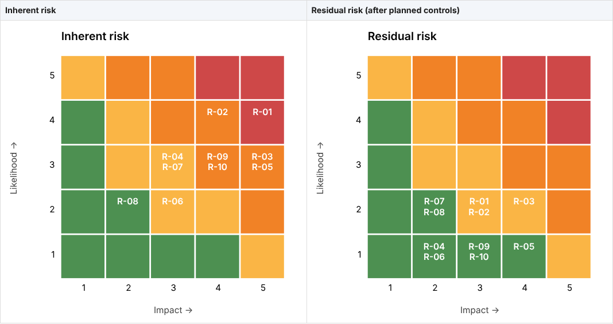

# Project 05: NIST CSF 2.0 Gap Assessment, Risk Register & Policy Set

**Skills shown:** governance, risk & compliance (GRC) · NIST CSF 2.0 profiling · quantitative risk scoring · policy writing · executive/board reporting · Python

This project is a complete security program assessment for a fictional multi-site nonprofit, *Example Community Services*. It produces the deliverables an IT Director or GRC analyst brings to leadership:

1. **CSF 2.0 Current vs. Target Profile** covering all **6 Functions and 22 Categories**, including the new **Govern** function.
2. **Risk register** with inherent and residual likelihood × impact scoring, treatments, owners and a risk-appetite check.
3. **`grc_report.py`**, which generates an executive report (Markdown and a self-contained HTML version you can print to PDF), a prioritized 90-day / 6-month / 12-month **roadmap**, and SVG heat maps.
4. **Three policy templates** (Information Security, Access Control, Vendor Risk Management) and a written **assessment methodology**.

  

---

## Results

```
[+] 22 CSF categories, 22 gaps, 10 risks
    Govern    current 1.33 target 3.0
    Identify  current 1.67 target 3.0
    Protect   current 1.8  target 3.2
    Detect    current 1.0  target 3.0
    Respond   current 1.25 target 3.0
    Recover   current 1.0  target 3.0
    Top 90-day items: PR.AA, GV.RM, GV.PO, GV.SC, DE.CM
    Risks exceeding appetite after treatment: R-03
```



The planned controls bring **9 of 10 risks** within the board-approved appetite (residual ≤ 6). Ransomware (R-01) drops from **20 → 6**, a 70% reduction. The vendor-breach risk (R-03) is still above appetite, so the report escalates it for a formal executive decision. That is how a risk register is supposed to work.

**Full report:** [`reports/grc_report.md`](reports/grc_report.md). For the styled version, download [`reports/grc_report.html`](reports/grc_report.html) and open it in a browser.

## What's in the box

```
05-grc-csf2-risk-assessment/
├── grc_report.py                         # Analysis + report generator (stdlib only)
├── config.json                           # Org name, risk appetite, scoring bands
├── assessment/csf2_profile.csv           # 22 categories: current, target, weight, owner, evidence
├── risk/risk_register.csv                # 10 risks: inherent/residual L×I, treatment, CSF mapping
├── policies/
│   ├── information-security-policy.md    # Governance, roles, risk appetite, minimum controls
│   ├── access-control-policy.md          # Lifecycle, MFA, NIST SP 800-63B-4 passwords, PAM
│   └── vendor-risk-management-policy.md  # Tiering, contract clauses, 12-question questionnaire
├── docs/methodology.md                   # Scoping, evidence, scoring, prioritization
├── reports/                              # Generated outputs
└── tests/test_grc.py
```

## Standards alignment

| Standard | How it's used |
|---|---|
| **NIST CSF 2.0** (Feb 2024) | Organizational Profiles (Current/Target) across all 22 Categories; Tier names reused as the per-category maturity scale |
| **NIST SP 800-30 Rev. 1** | Likelihood × impact risk assessment approach |
| **NIST SP 800-63B-4** | Password and authenticator requirements in the Access Control Policy |
| **NIST SP 800-161 Rev. 1** | Supply-chain (vendor) risk management |
| **CIS Controls v8.1** | Controls 5, 6 and 15 referenced in policies; KPIs map to safeguards |
| **ISO/IEC 27001:2022** | Policy structure compatible with Clause 5.2 (policy) and Clause 6.1 (risk treatment) |

## Quick start

```bash
python3 grc_report.py                 # uses the sample data and writes to reports/
python3 -m unittest discover -s tests -v
```

## Adapting to your organization

1. **Profile:** edit `assessment/csf2_profile.csv`. Score each category 0–4 using the evidence rules in [`docs/methodology.md`](docs/methodology.md). Set realistic targets, since not everything needs to be a 4. Use `weight` to reflect your own top risks.
2. **Risks:** replace `risk/risk_register.csv` with your own. Keep the columns.
3. **Appetite:** set `risk_appetite_max_residual` in `config.json` to the level your board approves.
4. **Policies:** swap in your organization name, roles and legal obligations. Have legal and HR review before adoption.

| Organization type | Tips |
|---|---|
| Small nonprofit / SMB | Target 2–3 across the board. Prioritize PR.AA (MFA), RC.RP (backups) and GV.SC (SaaS vendors) |
| Healthcare | Add HIPAA Security Rule mapping. Raise targets for PR.DS and DE.CM |
| Retail / payments | Add PCI DSS v4.0.1 requirements to the profile and risk register |
| Enterprise | Run per business unit and roll up. Add a column for subcategory-level scoring |

## Lessons learned

1. **Govern comes first.** The new CSF 2.0 Govern function exposed the root cause of most technical gaps: no risk appetite, no policy set, no board oversight.
2. **Weighting turns a checklist into a strategy.** Without weights every gap looks equal. With them, MFA (PR.AA) clearly leads the 90-day plan.
3. **Residual risk tells the story.** Leadership doesn't fund controls. They fund risk reduction ("ransomware 20 → 6").
4. **Escalation is a feature.** A register where every risk is green after treatment is usually wrong. R-03 shows the process working as designed.
