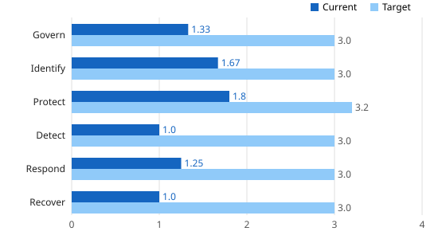
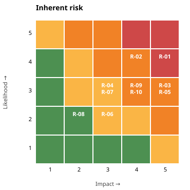
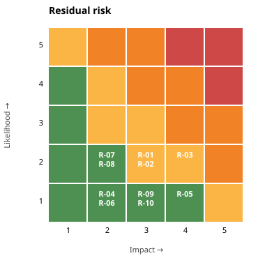

# Cybersecurity Program Assessment: Example Community Services (fictional nonprofit)

*Framework:* NIST Cybersecurity Framework (CSF) 2.0 · *Assessment date:* 2026-10-29  
*Scale:* 0 Not implemented · 1 Partial · 2 Risk Informed · 3 Repeatable · 4 Adaptive

## Executive summary

- **Overall maturity:** 1.41 / 4 today against a target of 3.05. **22 of 22** CSF categories are below target.
- **Weakest function:** Detect (1.0). **Strongest:** Protect.
- **Top risks:** R-01 Ransomware encrypts file servers and backups (20/25); R-02 Business email compromise / account takeover (16/25); R-03 Client PII exposed through SaaS vendor breach (15/25).
- After the planned controls, **9 of 10** risks fall within the approved appetite (residual ≤ 6). **1** still needs formal executive risk acceptance or additional controls: R-03.

## Maturity by CSF function

| Function | Categories | Current | Target | Gap |
|---|---|---|---|---|
| Govern | 6 | 1.33 | 3.0 | 1.67 |
| Identify | 3 | 1.67 | 3.0 | 1.33 |
| Protect | 5 | 1.8 | 3.2 | 1.4 |
| Detect | 2 | 1.0 | 3.0 | 2.0 |
| Respond | 4 | 1.25 | 3.0 | 1.75 |
| Recover | 2 | 1.0 | 3.0 | 2.0 |

## Prioritized improvement roadmap

Priority score = (target − current) × business weight. The top five items form the 90-day plan.

| # | Phase | Category | Current → Target | Score | Owner | Evidence / gap |
|---|---|---|---|---|---|---|
| 1 | 0-90 days | **PR.AA** Identity Management, Authentication, and Access Control | 2 → 4 | 4.0 | IT Director | MFA on M365 for staff; not on admin/VPN; shared accounts at 2 sites; Highest-risk gap |
| 2 | 0-90 days | **GV.RM** Risk Management Strategy | 1 → 3 | 3.0 | IT Director | No board-approved risk appetite statement; Risk decisions made ad hoc |
| 3 | 0-90 days | **GV.PO** Policy | 1 → 3 | 3.0 | IT Director | Acceptable Use policy (2021) only; Draft policies in /policies |
| 4 | 0-90 days | **GV.SC** Cybersecurity Supply Chain Risk Management | 1 → 3 | 3.0 | Operations Manager | Vendor list exists; no security due diligence; 14 SaaS vendors hold client data |
| 5 | 0-90 days | **DE.CM** Continuous Monitoring | 1 → 3 | 3.0 | IT Director | Defender AV alerts only; logs not centralized |
| 6 | 3-6 months | **RS.MA** Incident Management | 1 → 3 | 3.0 | IT Director | No written IR plan; Playbook in Project 01 |
| 7 | 3-6 months | **RC.RP** Incident Recovery Plan Execution | 1 → 3 | 3.0 | IT Director | Backups exist; restore never tested |
| 8 | 3-6 months | **GV.OV** Oversight | 1 → 3 | 2.0 | Board Finance Committee | No security reporting to the board; Quarterly KPI dashboard proposed |
| 9 | 3-6 months | **PR.AT** Awareness and Training | 1 → 3 | 2.0 | HR Director | Annual video only; Phishing simulation program planned |
| 10 | 3-6 months | **DE.AE** Adverse Event Analysis | 1 → 3 | 2.0 | IT Director | No correlation/triage process; Triage toolkit (Project 01) |
| 11 | 3-6 months | **RS.AN** Incident Analysis | 1 → 3 | 2.0 | IT Director |  |
| 12 | 3-6 months | **RS.CO** Incident Response Reporting and Communication | 1 → 3 | 2.0 | Executive Director | No notification templates or legal contact |
| 13 | 6-12 months | **ID.AM** Asset Management | 2 → 3 | 1.5 | IT Director | RMM agent inventory covers ~85% of endpoints; No SaaS/data inventory |
| 14 | 6-12 months | **ID.RA** Risk Assessment | 2 → 3 | 1.5 | IT Director | Monthly vuln scans (Project 02); First formal risk register in this project |
| 15 | 6-12 months | **PR.DS** Data Security | 2 → 3 | 1.5 | IT Director | BitLocker on laptops; backups not immutable; Client PII in file shares |
| 16 | 6-12 months | **GV.OC** Organizational Context | 2 → 3 | 1.0 | Executive Director | Mission statement; list of regulatory obligations (HIPAA for client health data; state breach law); Stakeholder cyber expectations not documented |
| 17 | 6-12 months | **GV.RR** Roles, Responsibilities, and Authorities | 2 → 3 | 1.0 | HR Director | IT Director owns security; no RACI; Need RACI and security duties in job descriptions |
| 18 | 6-12 months | **ID.IM** Improvement | 1 → 3 | 1.0 | IT Director | No lessons-learned process |
| 19 | 6-12 months | **PR.PS** Platform Security | 2 → 3 | 1.0 | IT Director | Patch via RMM; no config baseline; CIS baselines (Project 02 audits) |
| 20 | 6-12 months | **PR.IR** Technology Infrastructure Resilience | 2 → 3 | 1.0 | IT Director | Flat network at 3 of 5 sites; Segmentation design in Project 04 |
| 21 | 6-12 months | **RS.MI** Incident Mitigation | 2 → 3 | 1.0 | IT Director | Can isolate endpoints via Defender |
| 22 | 6-12 months | **RC.CO** Incident Recovery Communication | 1 → 3 | 1.0 | Executive Director |  |

## Risk register

| ID | Risk | Inherent (L×I) | Treatment | Residual | Reduction | Appetite | Owner | Due |
|---|---|---|---|---|---|---|---|---|
| R-01 | Ransomware encrypts file servers and backups | 4×5 = **20** (critical) | Mitigate: Immutable/offline backups; segmentation; EDR; restore tests | 6 (medium) | 70% | ✅ | IT Director | 2027-01-31 |
| R-02 | Business email compromise / account takeover | 4×4 = **16** (high) | Mitigate: Phishing-resistant MFA for admins; Conditional Access; block legacy auth | 6 (medium) | 62% | ✅ | IT Director | 2026-12-15 |
| R-03 | Client PII exposed through SaaS vendor breach | 3×5 = **15** (high) | Mitigate: Vendor security questionnaire; SOC 2 review; DPA clauses | 8 (medium) | 47% | ⚠️ exceeds | Operations Manager | 2027-02-28 |
| R-05 | Unpatched internet-facing VPN exploited | 3×5 = **15** (high) | Mitigate: KEV-driven 7-day patch SLA (Project 02); ZTNA evaluation | 4 (low) | 73% | ✅ | IT Director | 2026-11-30 |
| R-09 | Delayed breach notification triggers penalties | 3×4 = **12** (high) | Mitigate: IR plan; legal retainer; notification templates | 3 (low) | 75% | ✅ | Executive Director | 2026-12-31 |
| R-10 | Cyber insurance claim denied | 3×4 = **12** (high) | Transfer: Validate attestations; close MFA/EDR gaps before renewal | 3 (low) | 75% | ✅ | Finance Director | 2027-01-15 |
| R-04 | Lost/stolen laptop with client data | 3×3 = **9** (medium) | Mitigate: Intune compliance policy requiring encryption; remote wipe | 2 (low) | 78% | ✅ | IT Director | 2026-12-31 |
| R-07 | Extended outage at main site | 3×3 = **9** (medium) | Mitigate: Secondary ISP; documented and tested DR runbook | 4 (low) | 56% | ✅ | IT Director | 2027-04-30 |
| R-06 | Insider misuse of shared accounts | 2×3 = **6** (medium) | Mitigate: Named accounts; access reviews quarterly | 2 (low) | 67% | ✅ | Site Managers | 2027-03-31 |
| R-08 | Website defacement | 2×2 = **4** (low) | Accept: Accept within appetite; monitor | 4 (low) | 0% | ✅ | Communications Lead | 2027-06-30 |

| Inherent risk | Residual risk (after planned controls) |
|---|---|
|  |  |

## Recommended board reporting (quarterly)

| KPI | Why it matters | CSF |
|---|---|---|
| % of accounts with phishing-resistant MFA (admins / all staff) | Account takeover is the top initial-access vector | PR.AA |
| Open KEV vulnerabilities older than 7 days | Exploited-now exposure | ID.RA, PR.PS |
| Days since last successful restore test | Ransomware recoverability | RC.RP |
| Phishing simulation click rate / report rate | Human-layer resilience | PR.AT |
| Critical vendors with a current security review | Third-party exposure | GV.SC |
| Mean time to detect / contain (incidents) | Response effectiveness | DE.AE, RS.MA |
