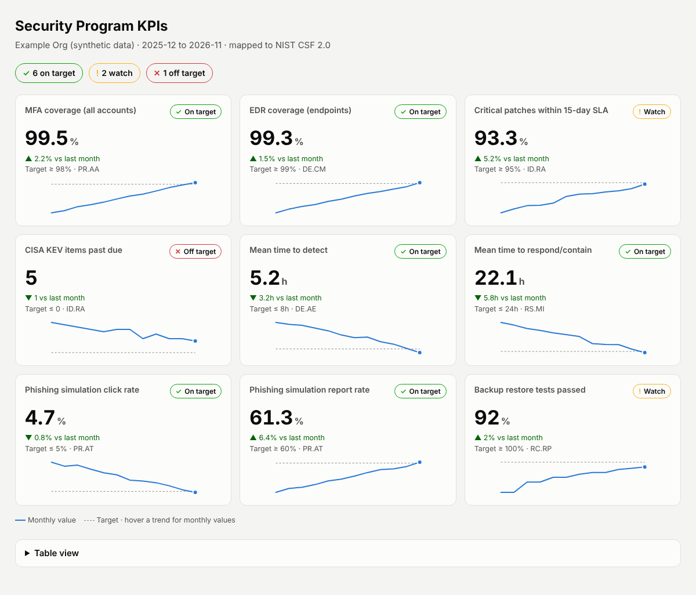

# Project 13: Security Program Management

**Skills shown:** incident response program management · tabletop exercise design (HSEEP style) · after-action reporting · third-party / vendor risk management · security metrics and KPIs · executive reporting · escalation and RACI design · NIST CSF 2.0 governance

Technical skill finds problems. Program management makes sure they get fixed, measured and reported. This project contains the tools a security program manager uses every month: an exercise to test the incident response plan, a vendor risk register, a KPI dashboard for leadership, and the escalation rules that tie them together.

| Component | What it does |
|---|---|
| [**Ransomware tabletop kit**](tabletop/) | 8-inject, 2-hour exercise ([facilitator guide](tabletop/FACILITATOR_GUIDE.md)) covering detection to board briefing. [`score_exercise.py`](tabletop/score_exercise.py) scores team responses and drafts the [after-action report](reports/tabletop_aar.md) with an improvement plan |
| [**Vendor risk scorecard**](vendor_risk/vendor_risk.py) | Inherent risk (data × access × criticality) reduced by verified controls → residual score, tier, review cycle, overdue reviews and contract follow-ups. Output: [risk register](reports/vendor_risk.md) |
| [**Security KPI dashboard**](kpi/build_dashboard.py) | One self-contained HTML page from a metrics CSV: 9 KPIs with status, trend and target, light/dark mode and a table view. [**View live**](https://xwestsecured-png.github.io/xwestsecured.github.io/projects/13-security-program-management/reports/security_kpi_dashboard.html) |
| [**Severity & escalation matrix**](docs/incident-severity-and-escalation.md) | SEV-1 to SEV-4 definitions, notification times per role, RACI for major decisions, regulatory clocks |

  

---

## Results

### Tabletop exercise (sample team, synthetic)

```
Overall: 62% (Needs improvement)
  Detection & Analysis    70%  Adequate
  Containment             60%  Needs improvement
  Eradication             50%  Needs improvement
  Recovery                80%  Adequate
  Post-Incident           60%  Needs improvement
```

The AAR turns each missed action into a tracked item. The most important ones from the sample run: nobody raised **OFAC sanctions screening** before discussing a ransom payment, there were **no pre-agreed criteria** for a full network shutdown, the **on-call number was out of date**, and backups had not been restore-tested in 14 months.

### Vendor risk register

```
Vendor                 Inh  Ctl  Res  Tier      Overdue
NetWatch MSP            80  25%   81  Critical     551d
AIScribe Notes          32  50%   36  High           0d
PayrollCloud Inc.       60  95%   20  Moderate       0d
MarketMail Pro          16  75%    8  Low            0d
QuickPrint Supplies      1  10%    1  Low            0d
```

The managed service provider has privileged remote access with no MFA, the same path used in many supply-chain ransomware attacks. The AI transcription vendor trains models on customer data, so the register flags a contract opt-out. PayrollCloud holds the most sensitive data but has strong verified controls, so its residual risk is moderate.

### KPI dashboard



| KPI | CSF 2.0 | Why leadership should care |
|---|---|---|
| MFA coverage, EDR coverage | PR.AA, DE.CM | Gaps here are where most intrusions start |
| Critical patches in SLA, CISA KEV past due | ID.RA | KEV items are being exploited right now (BOD 22-01) |
| Mean time to detect / respond | DE.AE, RS.MI | Faster containment directly lowers breach cost |
| Phishing click rate and report rate | PR.AT | Report rate shows whether staff act as sensors |
| Backup restore tests passed | RC.RP | An untested backup is a hope, not a recovery plan |

## Quick start

```bash
python3 tabletop/score_exercise.py tabletop/ransomware_exercise.json tabletop/sample_responses.json --out reports/
python3 vendor_risk/vendor_risk.py vendor_risk/vendors.json --out reports/
python3 kpi/build_dashboard.py kpi/metrics.csv kpi/targets.json --out reports/security_kpi_dashboard.html
python3 -m unittest discover -s tests -v       # 9 tests
```

## Standards alignment

| Standard | Coverage |
|---|---|
| **NIST CSF 2.0** | GV.OC, GV.RM, GV.SC (supply chain), ID.IM (improvement), every KPI mapped to a subcategory |
| **NIST SP 800-61r3** | Incident response roles, communication and lessons learned |
| **NIST SP 800-84** | Test, training and exercise programs (tabletop design) |
| **NIST SP 800-161r1** | Cybersecurity supply chain risk management for vendors |
| **NIST SP 800-55** | Measurement guide for information security (KPI design) |
| **CISA Tabletop Exercise Packages (CTEP)** / **FEMA HSEEP** | Exercise structure, injects, hot wash, after-action report |
| **CISA KEV / BOD 22-01** | KEV-past-due KPI |
| **U.S. Treasury OFAC advisory** on ransomware payments | Sanctions check before any payment (tabletop inject 6) |

## Adapting to your environment

- **Tabletop:** edit `ransomware_exercise.json` (scenario, roles, injects, expected actions). The same scorer works for BEC, insider threat or cloud breach scenarios.
- **Vendors:** export your vendor questionnaire answers to the JSON format; adjust weights in `CONTROLS` and tier cut-offs to match your risk appetite.
- **KPIs:** add a column to `metrics.csv` and an entry to `targets.json` (label, unit, target, amber line, direction, CSF mapping). Most SIEM, EDR and vulnerability tools can export these monthly.

All organization names, vendors and figures are synthetic.
